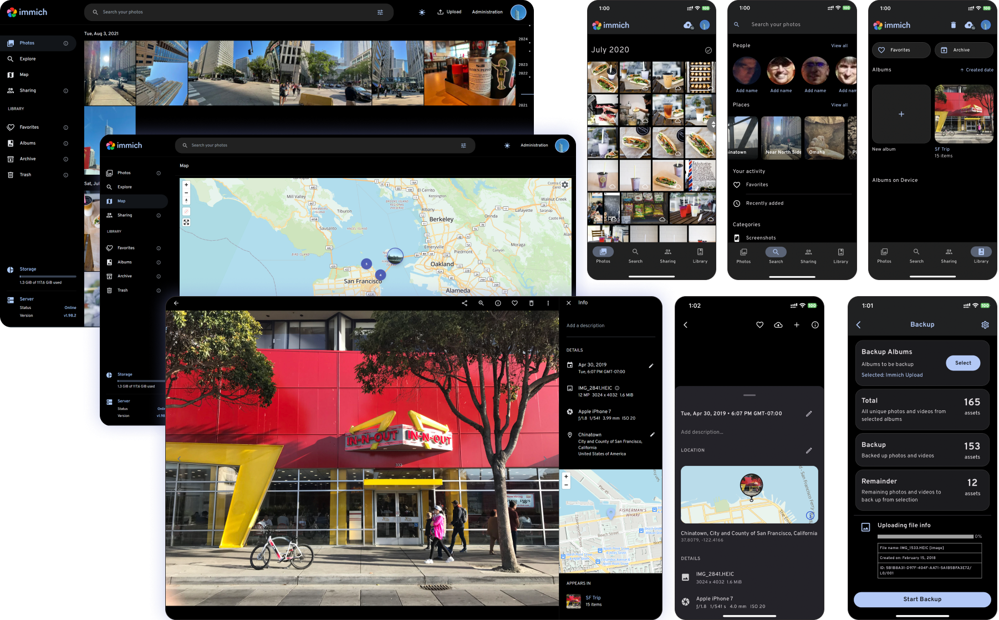

<p align="center"> 
  <br/>
  <a href="https://opensource.org/license/agpl-v3"></a>
  <a href="https://discord.immich.app">
    
  </a>
  <br/>
  <br/>
</p>

<p align="center">

</p>

<h3 align="center">High performance self-hosted photo and video management solution</h3>

<br/>

<p align="center">
  <strong>FORK PERSONALIZADO: Immich + Quiz + Obsidian</strong><br/>
  Galería fotográfica privada, autohospedada y con IA local para Windows.
</p>

<br/>

<a href="https://immich.app">

</a>

<br/>

## 📋 Descripción del Proyecto

Este es un **fork personalizado de Immich** que incluye integraciones adicionales para **Quiz** y **Obsidian**. Está diseñado específicamente para funcionar de manera nativa en **Windows** con Node.js v24, ofreciendo:

- Galería fotográfica y de videos autohospedada
- Soporte de IA local para reconocimiento facial, búsqueda por metadatos y CLIP
- Compatibilidad total con Windows (Node.js v24 nativo)
- Integraciones adicionales para Quiz y Obsidian

## 🏗️ Arquitectura y Entorno

| Componente | Tecnología | Puerto |
|------------|------------|--------|
| **Backend** | NestJS / Node.js v24 | 2283 |
| **Frontend** | Vite + SvelteKit | 3002 |
| **Base de Datos** | PostgreSQL | 127.0.0.1:5432 |
| **Caché** | Redis | 127.0.0.1:6379 |
| **ML Service** | PyTorch (Docker) | - |

## 🚀 Quick Start

### 1. Iniciar Servicios Docker

```powershell
# Iniciar PostgreSQL y Redis
docker start immich_postgres
docker start immich_redis

# Verificar están activos
docker ps --format "table {{.Names}}\t{{.Ports}}\t{{.Status}}" | findstr "immich"
```

### 2. Ejecutar Migraciones (Windows)

Debido a incompatibilidades de ESM en Node.js 24 con rutas de Windows, usa el script especial:

```powershell
cd server
node run-migrations-native.mjs
```

> **Nota**: Este script utiliza `pathToFileURL` para resolver correctamente los archivos de migración en Windows.

### 3. Arrancar el Backend

```powershell
cd server
pnpm install
pnpm run start:dev
```

### 4. Arrancar el Frontend

```powershell
cd web
pnpm install
pnpm run dev
```

### 5. Acceder a la Aplicación

- **Frontend**: http://localhost:3002/
- **API Backend**: http://localhost:2283/

## 📁 Estructura del Proyecto

```
immich-main/
├── server/                 # Backend NestJS
│   ├── src/               # Código fuente
│   ├── dist/              # Build compilado
│   ├── .env               # Variables de entorno
│   └── run-migrations-native.mjs  # Script de migraciones para Windows
├── web/                   # Frontend Svelte
│   ├── src/               # Código fuente
│   └── vite.config.ts     # Configuración de Vite
└── README.md              # Este archivo
```

## ⚙️ Variables de Entorno

El archivo `server/.env` debe tener estos valores para Windows:

```env
DB_HOST=127.0.0.1
DB_PORT=5432
DB_HOSTNAME=127.0.0.1
DB_USERNAME=postgres
DB_PASSWORD=postgres
DB_DATABASE_NAME=immich
REDIS_HOST=127.0.0.1
REDIS_PORT=6379
```

## 🔧 Solución de Problemas

### Error: ERR_UNSUPPORTED_ESM_URL_SCHEME

**Causa**: Node.js 24 en Windows no maneja correctamente rutas absolutas con ESM.

**Solución**: Usa `run-migrations-native.mjs` que resuelve las rutas usando `pathToFileURL`.

### Error: ENOTFOUND database

**Causa**: Docker resolvió `database` a través de la red interna.

**Solución**: Configura `DB_HOSTNAME=127.0.0.1` en `.env` para conexión directa.

## 📚 Documentación

- [Documentación oficial](https://docs.immich.app/)
- [Instalación](https://docs.immich.app/install/requirements)
- [Características](https://docs.immich.app/features)

## 🤝 Contribuir

Este fork está bajo licencia AGPLv3. Ver [LICENSE](LICENSE) para más detalles.

<a href="https://github.com/immich-app/immich/graphs/contributors">
  
</a>